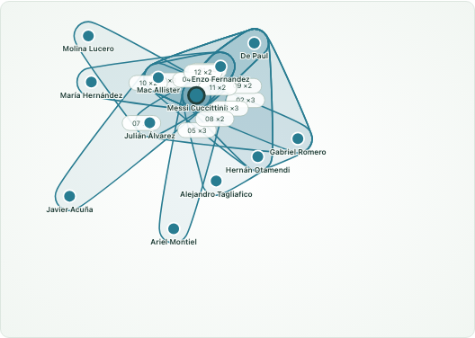

# Football HyperGraph Explorer

**基于真实足球事件，交互探索球员的多人协作、跨队对抗与个人表现。**

Data Visualization 期中四人团队项目，演示赛事为 **2022 世界杯决赛：阿根廷 vs 法国**。Python 标准库负责预处理，原生 JavaScript ES Module 与本地 D3.js 负责交互；无需数据库、应用后端或前端构建。A/B/C/D 共用真实数据与统一状态，B 提供唯一的双模式主超图。

**截至 2026-10-30：核心功能已完成真实数据联调；D 正式展示材料、全组报告和最终提交包仍待收尾。** 最新结果见 [全组复核](docs/AUDIT_2026-10-30.md)。早期文档中的“其他模块未交付”属于独立开发阶段。

## 1. 快速开始

### 离线演示版：双击即可打开

需要在无网络的教室演示时，使用生成的**单文件 HTML**。打开它只需要现代 Chrome 或 Edge，不需要 Python、Node.js、本地服务器或网络。

先在项目根目录准备一次真实数据，再生成离线包：

```powershell
python scripts/prepare_data.py
python scripts/build_offline.py
```

已有完整源缓存时，第一条可改为 `python scripts/prepare_data.py --offline`。第二条只读取本地文件，不下载数据；缺少五份 JSON 时明确失败，不使用模拟值替代。确认每条命令成功后再继续。macOS/Linux 可将 `python` 换成 `python3`。

生成位置：

| 文件 | 打开方式与用途 |
| --- | --- |
| `output/offline/Football-HyperGraph-Explorer.html` | 双击或用 Chrome/Edge 打开；可只复制这一个文件到其他目录或演示电脑 |
| `output/Football-HyperGraph-Explorer-offline.zip` | 拷贝用压缩包；先解压，再打开其中的 `index.html`，附有使用说明及来源/D3 许可文件 |

离线版内置同一场真实比赛的全部五份数据、现有 A/B/C/D 模块、本地 D3、样式和 StatsBomb 标志。保留比赛概览、主图拖拽缩放、协作/对抗模式、球员搜索、射门与对比、时间/球队筛选、事件证据等功能。它复用正式渲染器与状态接口，没有另外绘制一套简化主图。

离线文件是**生成时的快照**：修改源码、样式或数据后，重新运行 `python scripts/build_offline.py`，已有离线页不会自动同步；浏览器内操作也不会改写源 JSON。开发版 `src/index.html` 仍须通过 HTTP 打开，不能用双击开发文件代替生成离线包。

页面无需任何外部请求。主动点击数据来源的外部链接仍需网络；页面底部另有离线说明、内置的 StatsBomb 许可下载及 D3 许可。离线包包含逐事件数据，保存在已被 Git 忽略的 `output/`，不要将生成包误提交到公开仓库；转发或发布前沿用下文的源数据许可要求。此 ZIP 是网页演示包，不是包含全组报告与幻灯片的最终课程提交包。

可选自定义输出目录（不可覆盖源代码或数据目录）：

```powershell
python scripts/build_offline.py --output output/classroom/index.html --zip output/classroom-demo.zip
```

### 开发版：本地 HTTP 服务

| 用途 | 依赖 |
| --- | --- |
| 数据准备与本地服务 | Python 3.10+，仅标准库 |
| 使用网页 | 支持 ES Module 的现代浏览器，如 Chrome / Edge |
| JavaScript 测试（开发时） | Node.js 22.7+ |
| 浏览器测试（开发时） | Playwright 与可用的 Chrome / Edge / Chromium |

网页运行不需要 `npm install`。D3 7.9.0 随源码提供，没有运行时 CDN 请求；首次准备数据需要访问固定版本的 StatsBomb 源文件。

在**项目根目录**执行（Windows PowerShell）：

```powershell
python scripts/prepare_data.py
```

确认成功后启动服务：

```powershell
python -m http.server 8000 --bind 127.0.0.1
```

打开 **[整合页面](http://127.0.0.1:8000/src/)**。不要双击 HTML 或使用 `file://`。macOS/Linux 可将 `python` 换成 `python3`。按 `Ctrl+C` 停止服务。

完整源缓存存在后，可离线校验并重建全部五份 JSON：

```powershell
python scripts/prepare_data.py --offline
```

离线模式仍检查源文件哈希；缺失或损坏即失败，不回退模拟数据。默认结果应为 **50 名名单球员、4407 条事件、531 条协作超边、385 条对抗超边**。



*节点位置是关系布局，不是球场站位。完整组合聚合显示，默认 Top 12，可切换 Top 24；原始片段数与显示组合数分别说明。*

| 页面 | 数据与用途 |
| --- | --- |
| [/src/](http://127.0.0.1:8000/src/) | **正式整合入口**，加载 A/B/C/D 的五份真实数据 |
| [/demos/data-a/](http://127.0.0.1:8000/demos/data-a/) | A 的真实数据独立验收页，默认深色，可切换浅色 |
| [/demos/player-c/](http://127.0.0.1:8000/demos/player-c/) | C 的**模拟数据**测试页，不能用于真实比赛结论 |

## 2. 如何探索比赛

建议顺序：**选球员 → 看超边 → 展开事件依据 → 切模式 → 改时间 → 对照个人指标**。

### 球星与关系

1. 在 C 面板搜索或快捷选择 Messi / Mbappé，查看时段指标与全场对照。点击 B 主图节点也会选人，相关组合优先显示并高亮。
2. 滚轮缩放、拖动空白处平移、拖拽球员节点，或使用放大/缩小、重置按钮。节点可键盘聚焦，Enter 选人、方向键移动节点。
3. 点击包络、编号或组合按钮，查看完整成员、原始片段时间、超边 ID 与源事件。图中 `×N` 是相同完整成员集合的频次，不是原始边权重。
4. C 的“多人关系”提供伙伴频次、完整组合列表/成员矩阵与事件证据。点击伙伴可切换聚焦对象，点击组合请求 B 高亮该完整组合。
5. “射门分析”展示位置分布、事件清单、xG 与结果；坐标缺失时保留清单，不编造位置，不混入点球大战。
6. “球员对比”在同一时段与模式下比较两人，保留原始单位、成功率百分点与 N/A；支持交换主副球员。

### 模式、球队与时间

- 顶部 D 控件切换 **Collaboration / Competition**，复用同一个 B 主图。
- 双端点滑块和分钟输入支持小数、精确边界与零宽区间。端点交叉时将另一端推至同一值；“查看全场”恢复实际最大分钟，不硬编码 130。
- 超边按区间相交过滤：`edge.end_minute >= start && edge.start_minute <= end`。触及边界的片段完整计一次；个人指标按闭区间内的事件点重新计算。
- 球队筛选保留包含该队的竞争边及其**全部跨队成员**。球员选择请求高亮，不删除其他球员原始数据。
- D 计数为当前模式/球队/时间内的原始片段数；B 的 Top-K 只限制显示组合，不改变 C 的原始参与量。
- 时间条表示每 5 分钟**已记录的对抗事件数**，不是完整对抗强度或逐帧动画。本版未提供自动播放。

### 比赛概览

A 的浅色仪表盘展示比分、进球者、点球大战序列、事件分布、xG 走势、两队对比、射门分布及球员/事件列表。

- 可筛选球队、阶段、事件类型；从概览选人会回到球星视角。
- xG 图仅允许同阶段内拖选并共享分钟；跨阶段拖选提示后保留原条件。
- **A 的阶段与事件类型是本地筛选**，不会成为 B/C 的阶段/类型筛选。共享分钟可能同时覆盖补时与下一阶段重叠时钟。
- 指标和列表响应相应条件；事件分布/射门图保留事件类型上下文，两队对比保留双方，xG 曲线保留全场参考。详见 [A 模块说明](docs/DATA_A.md)。
- “无关联事件”仅描述记录覆盖，不代表未登场，例如 Disasi 在加时末段已有替补上场依据。

## 3. 数据来源、口径与限制

来源：[StatsBomb Open Data](https://github.com/hudl/open-data)，固定 commit `4b73468fc5b0f1950f9f66fada70ad3a4f9327cb`。比赛 ID `3869685`，日期 2022-12-18；阿根廷队 ID `779`，法国队 ID `771`。源路径与预期 SHA256 位于 `scripts/load_data.py`，本地清单为 `data/raw/source_manifest.json`；字段字典见 [DATA_A.md](docs/DATA_A.md)。

| 核对项 | 默认重建结果 |
| --- | ---: |
| 名单人数 / 有事件记录人数 | 50 / 34 |
| 全部事件 / 第 1–4 节 / 点球大战 | 4407 / 4386 / 21 |
| 含加时比分 / 点球大战比分（阿根廷 : 法国） | 3:3 / 4:2 |
| 阿根廷传球 / 明确成功 / 射门 | 693 / 560 / 20 |
| 法国传球 / 明确成功 / 射门 | 570 / 434 / 10 |
| 原始协作边 / 原始对抗边 | 531 / 385 |

名单不等于同时在场阵容，也不意味着观察到了所有球员的逐帧动作。

### 指标与时钟

- 个人传球、射门、进球与 xG 排除第 5 节点球大战，点球大战在概览单列。进球依据明确的射门结果，不随意归属乌龙球或未知结果。
- A 的成功率为“已确认成功传球 / 全部传球”的保守比例。10 次源结果 `Unknown` 不当成功；C 在含未知结果的时段显示成功率 N/A，并解释全场对照口径。
- 零传球的成功率为 N/A。时段助攻因事件契约缺少完整标记而为 N/A；全场助攻可读取 `stats.json`，不靠传球对象猜助攻。
- xG 只汇总真实且完整有效的字段，不用已知部分冒充完整总量。坐标来自源 120×80 球场体系，不补位置或猜攻防方向。
- 源时钟有 6 次回退，其中 2 次在同阶段接球记录。保留原时钟，按 `(period, event_index)` 排序；共享分钟筛选可能同时覆盖补时与下一阶段的重叠分钟。

### 两种超边

**协作（B）**：同阶段、同队、连续控球内的明确成功传球链，下一发起者须对应上一传球对象；默认最多 4 次传球、20 秒、5 名球员，至少三人。失败/未知传球、对手事件、阶段/控球变化及时间回退切断链。详见 [B 建模与主图](docs/HYPERGRAPH_B.md)。

**对抗（D）**：以实际存在的 Pressure、Duel、Interception、Dispossessed、Ball Recovery 为锚点，在同阶段、同一连续控球片段内取中心前后各 2.5 秒的窗口。仅收集明确的发起者及同队 Pass 传球对象；至少三人、两队且双方有发起事件。默认最多 8 人、24 个上下文事件；证据不足不生成。传球对象只证明被记名，不证明成功接球。

每条原始边保存 `event_ids`、起止分钟、去重球员/球队、`weight=1`；竞争边标为 `evidence_type="event_window_inference"`。完整集合可单独聚合频次，不能用聚合权重替代原始边。窗口可能重叠，531/385 条边不是同等数量的独立进攻/对抗。

**竞争边是短窗口事件关联推断，不是完整逐帧站位或直接一对一对抗。** 审计中 3/5/8 秒窗口分别生成 297/385/440 条边，说明数量依赖设计参数；不能据此判断哪个参数最优或比赛竞争更激烈。

## 4. 结构与团队职责

```text
football-hypergraph-explorer/
├── README.md
├── scripts/
│   ├── prepare_data.py          # 整组重建入口
│   ├── load_data.py             # A：固定源下载、校验
│   ├── preprocess.py            # A：名单与事件规范化
│   ├── calculate_stats.py       # A：比赛/球员统计
│   ├── build_collaboration.py   # B：协作传球链
│   └── build_competition.py     # D：跨队事件窗口
├── data/                       # 本地生成，原始/派生事件数据不纳入 Git
│   ├── raw/
│   └── processed/
├── src/
│   ├── index.html              # 整合入口
│   ├── css/                    # 页面壳及模块样式
│   ├── assets/                 # 来源标志
│   └── js/
│       ├── main.js             # 数据加载、校验与挂载
│       ├── state.js            # D：统一状态
│       ├── dataExplorer.js     # A：比赛概览
│       ├── hypergraph.js       # B：唯一双模式主图
│       ├── playerAnalysis.js   # C：关系、射门与对比
│       ├── competitionTimeline.js # D：模式、球队与时间
│       └── vendor/             # 本地 D3 与许可证
├── demos/                      # A 真实验收页 / C 模拟测试页
├── tests/                      # 单元、集成、浏览器与原始证据审计
├── docs/                       # 模块说明、report/、slides/、screenshots/
└── output/                     # 本地日志与临时输出，不纳入 Git
```

| 成员 | 主要贡献 | 正式开发分支 |
| --- | --- | --- |
| A | 数据清洗/统计、比赛概览、报告总编与打包协调 | `feature/data-A` |
| B | 协作超边、唯一 D3 主图、布局和证据交互 | `feature/hypergraph-B` |
| C | 搜索、关系与组合、射门、同窗球员对比 | `feature/player-C` |
| D | 跨队对抗、状态、时间/模式控件、总装联测 | `feature/timeline-D` |

各人维护自己的模块；共享接口或其他成员文件变更应先明确影响并按团队流程确认。功能分支测试、精确暂存、PR 审核后合入 `main`，不直接向 `main` 推送功能代码、不强制覆盖历史。当前检出未包含正式团队规范文件，本文不能替代全组确认的契约版本。

## 5. 五文件与前端接口

| 文件（`data/processed/`） | 负责人 | 内容 |
| --- | --- | --- |
| `players.json` | A | 球员身份、姓名、球队、位置、球衣号；不可得字段保留 null |
| `events.json` | A | 事件 ID、顺序/阶段、时间、发起者/球队、类型、控球、传球对象、结果、坐标、xG |
| `stats.json` | A | 比赛 ID、球队统计与按球员 ID 索引的全场指标 |
| `collaboration_edges.json` | B | 带来源、成员与时间的原始协作边 |
| `competition_edges.json` | D | 同一结构的跨队推断边 |

ID 为字符串标识符，不作为数组下标。四模块收到同一份 dataset 与 store：

```javascript
const dataset = { players, events, stats, collaborationEdges, competitionEdges };
mountDataExplorer(containerA, store, dataset);
mountHypergraph(containerB, store, dataset);
mountPlayerAnalysis(containerC, store, dataset);
mountCompetitionTimeline(containerD, store, dataset);
```

各模块只操作自己的容器；A 可选第四参数 `{ theme: "light" }`，整合页已使用浅色。统一状态由 `src/js/state.js` 导出：

```javascript
import * as store from "./state.js";
store.getState();
store.setState({ selectedPlayerId: "5503" });
store.setState({ mode: "competition", timeRange: [80, 90] });
const unsubscribe = store.subscribe(state => { /* 更新本模块 */ });
unsubscribe();
```

状态只有 `selectedMatchId`、`selectedTeamId`、`selectedPlayerId`、`mode`、`timeRange`；模式为 `collaboration` / `competition`，区间为非负有序分钟闭区间，初始最大值从数据计算。销毁时调用模块清理接口，避免重复 SVG、订阅及监听。

C 可选冒泡事件 `playeranalysis:select-edges` 已由 B 监听，用于完整组合高亮，不新增状态字段。页面视角、C 比较对象、A 阶段/类型保持局部状态。

### 缺失与空数据

`loadDataset()` / `validateDataset()` 默认严格要求五份数据。正式启动显式启用 `allowUnavailableEdges`，仅将关系文件的 HTTP 404 保留为 `undefined` 并解释“未提供”，阶段性交付时其他模块仍可用。

- `[]`：文件有效但无符合条件的边，不代表比赛没有合作/对抗。
- `undefined`：关系文件未提供，不是已观察到零条。
- 基础数据缺失、网络错误、HTTP 500、非法 JSON、无效引用/证据：报错，不静默替换为模拟数据。

## 6. 重建参数与诊断

准备脚本实际顺序为 **A 下载/校验 → A 规范化 → A 统计 → D 对抗边 → B 协作边**，任一步非零退出即停止。单独运行时也须检查退出码。

```powershell
python scripts/load_data.py --offline
python scripts/preprocess.py
python scripts/calculate_stats.py
python scripts/build_competition.py --window-seconds 5 --max-players 8 --max-events 24 --diagnostics output/competition-build-audit.json
python scripts/build_collaboration.py --max-passes 4 --max-seconds 20 --max-players 5
```

首次手动准备去掉下载命令的 `--offline`；`--force` 重新下载固定版本，不能与 `--offline` 同用。只有下载脚本需要联网。

源清单/时间异常诊断在 `data/raw/`；本次 B/D 摘要在 `output/{collaboration,competition}-build-audit.json`。`docs/*audit-real.json` 是历史快照，当前结果以本地日志为准。

A 支持 `--raw-dir` / `--output-dir`；B/D 支持 `--players` / `--events` / `--output` / `--diagnostics`。默认路径相对脚本所在仓库。使用自定义目录时后续步骤须显式读取对应输入，网页仍默认读 `data/processed/`。

单独验收 A 的新输出目录可用以下命令，不清空其他成员数据：

```powershell
python scripts/preprocess.py --output-dir output/rebuild-A
python scripts/calculate_stats.py --output-dir output/rebuild-A
```

合法但证据不足的 B/D 输出可为 `[]`。D 输入缺失/无效时也会写空数组并返回退出码 2，防止旧边残留；**不能只看文件存在或为空就判断构建成功**。

## 7. 测试与独立审计

### 离线包专项验证

先生成离线包，再执行：

```powershell
python -m unittest discover -s tests -p test_build_offline.py -v
```

安装下文的 Playwright 并选择浏览器后，还可运行：

```powershell
node --test tests/offline.browser.mjs
```

专项浏览器测试设置断网，通过 `file://` 打开 HTML，不启动服务器；检查只有 HTML 本身从磁盘读取、没有 HTTP/HTTPS 请求，并验证四模块、真实计数、球员与时间联动、100 次模式切换、独立复制与小屏布局。打包测试检查 JSON 安全嵌入、完整资源封装及输入缺失时保留已有文件。源码见 [生成脚本](scripts/build_offline.py)、[打包测试](tests/test_build_offline.py) 和 [断网浏览器测试](tests/offline.browser.mjs)。

2026-10-30 已实际运行的离线专项结果：3 项 Python 打包测试、7 项断网浏览器测试通过；离线接入后，原有 75 项 Node 与 27 项 D/B/真实集成 HTTP 浏览器回归也通过。该结果单独记录，不将此前 C 独立浏览器套件的已知失败改写为通过。

### 全组数据与功能验证

先准备数据再运行真实测试，缺少文件会明确失败，不自动回退 fixture。

```powershell
python -m unittest discover -s tests -p 'test_*.py' -q
node --test tests/dataExplorer.test.mjs tests/playerAnalysis.test.mjs tests/moduleD.test.mjs tests/hypergraph.test.mjs tests/integration.real.test.mjs
python tests/audit_data_A.py
python tests/audit_hypergraph_B.py
python tests/audit_competition_D.py
```

基础测试无需第三方测试库。A 审计源统计，B 审计成功传球链，D 逐条审计原始参与者、球队、阶段/控球连续性、锚点与精确时间；不把重复调用生产函数当作独立证据检查。

### 浏览器测试

可选开发依赖，Windows PowerShell 使用已有 Chrome：

```powershell
npm install --no-save --package-lock=false playwright
$env:PLAYWRIGHT_MODULE = 'playwright'
$env:PLAYWRIGHT_BROWSER_CHANNEL = 'chrome'
node --test tests/dataExplorer.browser.mjs tests/hypergraph.browser.mjs tests/moduleD.browser.mjs tests/integration.real.browser.mjs tests/playerAnalysis.browser.mjs
```

系统 Edge 通道设为 `msedge`；Playwright Chromium 先执行 `npx playwright install chromium`，再设为 `chromium`。macOS/Linux 示例：

```bash
PLAYWRIGHT_MODULE=playwright PLAYWRIGHT_BROWSER_CHANNEL=chromium node --test tests/hypergraph.browser.mjs
```

共享运行时可用 `PLAYWRIGHT_MODULE` 指向其 `index.mjs`；Windows 跨套件建议使用 `file:///C:/.../playwright/index.mjs` URL。也支持 `PLAYWRIGHT_CHROMIUM_EXECUTABLE` 指定浏览器。测试自行启动/关闭临时 HTTP 服务，不必预先运行 8000 端口。

A 浅色主题单独复测：

```powershell
$env:DE_THEME = 'light'
node --test tests/dataExplorer.browser.mjs
Remove-Item Env:DE_THEME
```

浏览器测试会更新 `docs/screenshots/`，运行前保留正式截图，提交前检查图片差异。

### 最近一次实际复核：2026-10-30

| 类别 | 结果与边界 |
| --- | --- |
| Python | 58/58 通过 |
| Node 单元/真实集成 | 75/75 通过 |
| 原版浏览器套件 | 59 项中 44 通过、15 失败；A 17、B 11、D 9、真实集成 7 通过 |
| C 独立演示浏览器测试 | 15 项因 Windows 测试服务路径判断在导航阶段失败；临时副本修正后 15/15 通过，正式文件未改，不能记为原版全通过 |
| A/B/D 原始证据独立审计 | 均通过；D 默认重提取与全部 385 条边一致 |

详见 [全组复核报告](docs/AUDIT_2026-10-30.md)。本 README 编辑未重跑整套浏览器验收；自动测试不等于个人审阅或课堂排练完成。

## 8. 常见问题

| 现象 | 检查与处理 |
| --- | --- |
| 基础 JSON 404 | 在仓库根目录运行 `prepare_data.py` 并确认成功；HTTP 服务根目录是仓库，不是 `src/` |
| 下载失败 / 哈希不符 | 检查网络与错误；完整缓存可用 `--offline`；不要跳过校验或手工伪造输入 |
| CORS / 模块无法加载 | 用 HTTP 访问 `/src/`，不要使用 `file://` |
| 关系“未提供” | 检查 B/D 生成步骤与退出码，和有效空数组分开处理 |
| 当前无边 | 恢复全场、清除球队筛选，再看提取摘要，不补造参与者 |
| 主图数量小于 D/C 计数 | 检查 Top-K 与组合聚合；显示组合数和原始片段数不同 |
| 指标为 N/A | 按未知/缺失/零分母解释，不任意补零 |
| A 选阶段后 C 数字不同 | 阶段为 A 本地筛选；共享分钟可能覆盖跨阶段的重叠时钟 |
| C 独立浏览器测试在 Windows 返回 403 | 已知测试根路径末尾分隔符问题，见复核报告；不能据此判定生产逻辑错误 |
| 离线页仍显示旧数据或界面 | 重新运行 `build_offline.py`，关闭旧标签页并打开新生成的 HTML；离线页不会自动读取源码目录 |
| 双击开发版 `src/index.html` 无法加载 | 开发版通过 HTTP 使用；直接打开只支持生成后的单文件离线 HTML |
| 端口 8000 占用 | 换成 `python -m http.server 8001 --bind 127.0.0.1`，访问同端口 `/src/` |
| 临时目录不可写 / 中文输出解码失败 | 设置可写临时目录和 UTF-8，复测后再判断代码问题 |

仅在需要处理上述本机测试环境问题时：

```powershell
New-Item -ItemType Directory -Force -Path output/test-temp | Out-Null
$env:TEMP = (Resolve-Path output/test-temp).Path
$env:TMP = $env:TEMP
$env:PYTHONUTF8 = '1'
$env:PYTHONIOENCODING = 'utf-8'
```

## 9. 文档、报告与展示

| 内容 | 入口 |
| --- | --- |
| 最新复核与缺口 | [AUDIT_2026-10-30](docs/AUDIT_2026-10-30.md) |
| 真实整合与跨模块联动 | [INTEGRATION_ACD](docs/INTEGRATION_ACD.md) |
| A 来源/口径、任务、验收、AI | [DATA_A](docs/DATA_A.md) · [TASK_CHECKLIST_A](docs/TASK_CHECKLIST_A.md) · [ACCEPTANCE_A](docs/ACCEPTANCE_A.md) · [AI_USAGE_A](docs/AI_USAGE_A.md) |
| B 建模/主图及测试 | [HYPERGRAPH_B](docs/HYPERGRAPH_B.md) · [TEST_RESULTS_B](docs/TEST_RESULTS_B.md) |
| C 球星接口与指标 | [PLAYER_C](docs/PLAYER_C.md) |
| D 方法/接口与早期测试历史 | [INTEGRATION_D](docs/INTEGRATION_D.md) · [TEST_RESULTS_D](docs/TEST_RESULTS_D.md)，当前状态优先看最新复核 |
| 报告草稿 | [A](docs/report/part_A.md) · [B](docs/report/part_B.md) · [C](docs/report/part_C.md) · [D](docs/report/part_D.md) |
| 正式三页幻灯片 | [A](docs/slides/part_A.pptx) · [B](docs/slides/part_B.pptx) · [C](docs/slides/part_C.pptx) |
| D 文字提纲（尚非 PPTX） | [part_D_outline](docs/slides/part_D_outline.md) |
| C 讲稿 | [part_C_notes](docs/slides/part_C_notes.md) |
| 总编与打包交接 | [ASSEMBLY_A](docs/report/ASSEMBLY_A.md) |

`hypergraph-b-*`、`player-c-real-*`、`data-a-*` 为真实数据运行截图；`player-c-demo-*`、`module-d-mock-*` 为模拟资料；`module-d-missing-data.png` 为缺失状态，不可混作完整真实比赛成果。D 报告与提纲仍须同步真实案例、敏感性结果和正式截图。

## 10. 许可、署名与 AI 使用

数据使用及再分发应遵循保留的 [StatsBomb 官方许可](docs/data_source/StatsBomb-LICENSE.pdf) 与 [官方 README 副本](docs/data_source/StatsBomb-README.md)。展示分析保留 StatsBomb 来源和官方标志，不把公开可下载理解为任意再分发授权。

原始数据和五份逐事件/派生 JSON 已由 `.gitignore` 排除，通过校验脚本在本地重建；不要强制加入 Git 或未经核对放入公开发布包。D3 许可见 [D3-LICENSE](src/js/vendor/D3-LICENSE)。这些资源的许可不自动等于项目自有代码的授权声明。

项目使用 Codex 等 AI 辅助接口分析、算法/前端实现、测试调试、截图检查和报告/演讲材料整理，各人记录见模块文档。模拟测试、真实观察和推断超边必须分开标注；最终报告须如实披露具体 AI 用途及实际人工审核范围。

## 11. 提交前收尾

- [x] A/B/C/D 五文件管道、唯一主图、球星与时间/模式联动已验收。
- [x] A/B/C 报告草稿、真实截图与三页 PPTX 已交付；结构可读不代表视觉和讲述均已人工审核。
- [ ] C 修复正式 Windows 浏览器测试路径兼容问题，重跑原版套件。
- [ ] D 更新真实报告案例、正式截图，补齐三页 PPTX 与讲稿。
- [ ] 全组统一 Results / Conclusion / References / AI 使用，生成根目录 `report.pdf`。
- [ ] 汇总全员幻灯片，完成每人最多 3 分钟排练与 Q&A 准备。
- [ ] 补齐正式团队契约及 Git 工作流文档，确认个人人工审核状态。
- [ ] 按实际组号制作 `Group-[组号].zip`，检查数据许可、大小 ≤50 MB，并在干净目录重建/运行。

最终交付结构沿用课程约定，当前尚未制作最终包：

```text
Group-[组号].zip
├── report.pdf
└── Visualization Appendix/
    ├── code/          # 源码、运行说明、合规数据重建方式
    ├── slides/        # 全员展示文件
    └── screenshots/   # 最终真实截图及明确标注的边界示例
```
