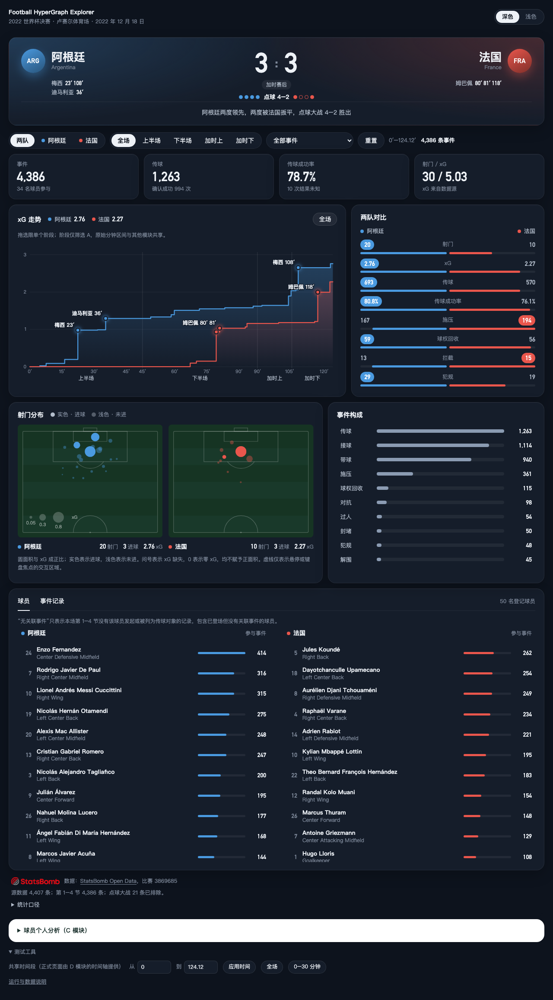

# A：数据处理与比赛概览

## 1. 项目介绍

足球比赛中的一次进攻往往涉及传球者、接球者以及后续参与配合的队员。两名球员之间的传球可以直接从事件记录中读取，而一段多人共同参与的配合还需要确定参与者、事件顺序和片段边界。Football HyperGraph Explorer 以多人关系为可视化对象，计划通过超边表达同一片段中的球员集合，并结合球员选择和时间筛选探索比赛。项目采用团队约定的“至少三名不同球员”作为原始超边的保留条件，避免把两两传球连线直接作为全部展示内容。（见组内《四人分工与 AI 协作说明》）

数据处理模块为这一目标提供共同输入：把原始赛事记录转换为球员表、事件表和统计表，使后续模块可以按照同一组 ID 查找参与者、回溯事件并对照个人指标。A 的实现范围包括数据获取、预处理、基础统计和比赛概览；协作超边、对抗超边及主超图分别由对应模块构建。本节的结果是对数据基础和 A 模块的检查，尚不代表完整超图系统已经通过集成验收。

项目的问题分为四个层次：RQ1 关注如何规范提取、统计和探索真实比赛数据；RQ2 关注如何用超边表达三人及以上的整体协作；RQ3 关注球星选择如何联动关系与表现分析；RQ4 关注跨队对抗如何随比赛时间变化。本节回答 RQ1，为其余三个问题提供统一数据与可追溯的事件依据，不预先把普通统计差异解释为超图分析结论。

## 2. 数据来源与字段

本项目选用 StatsBomb Open Data 中的 2022 年世界杯决赛，比赛日期为 2022 年 12 月 18 日，双方为阿根廷与法国，比赛 ID 为 `3869685`。数据版本固定为上游提交 `4b73468fc5b0f1950f9f66fada70ad3a4f9327cb`；下载脚本按该提交取得比赛事件、双方名单、比赛元数据及字段说明，并校验文件的 SHA-256。版本和校验值写入本地来源清单，便于其他成员重建相同输入，而不依赖上游最新版本是否变化。[固定版本数据源](https://github.com/hudl/open-data/tree/4b73468fc5b0f1950f9f66fada70ad3a4f9327cb)

原始文件包含 4407 条事件，其中第 1–4 节，即常规时间与加时赛，共 4386 条；第 5 节点球大战有 21 条。双方登记名单合计 50 人，34 人出现在球员事件字段中。34 是事件覆盖人数，并非登场人数：名单的位置时段记录显示 35 人登场，Disasi 在加时赛 120:35 替换 Koundé，但未出现在后续事件的发起者或传球对象字段中。名单人数包含未上场替补，不能作为同时在场人数。数据记录的是事件及其相关信息；本项目没有载入完整逐帧位置轨迹，因此事件中的坐标不能补全未记录球员的站位。[比赛事件](https://github.com/hudl/open-data/blob/4b73468fc5b0f1950f9f66fada70ad3a4f9327cb/data/events/3869685.json)、[球员名单](https://github.com/hudl/open-data/blob/4b73468fc5b0f1950f9f66fada70ad3a4f9327cb/data/lineups/3869685.json)

处理结果沿用团队约定的三份 JSON 文件。`players.json` 的每一行对应一名登记球员，`events.json` 保留全部事件，`stats.json` 汇总第 1–4 节的个人和球队表现。所有 ID 统一为字符串；缺失值保留为 `null` 或空列表，不从球衣号推断位置，也不凭传球对象是否存在判定传球成功。

| 文件 | 字段与类型 | 含义及处理方式 |
|---|---|---|
| `players.json` | `player_id`、`team_id`：字符串 | 与原始球员、球队 ID 对应 |
| `players.json` | `player_name`、`team_name`：字符串或 `null` | 使用来源中的名称；球员姓名缺失时仅允许从该球员的源事件补取 |
| `players.json` | `position`：字符串或 `null`；`shirt_number`：整数或 `null` | 位置取名单中首个有记录的位置，球衣号来自原始名单；位置不是整场固定角色 |
| `events.json` | `event_id`：字符串；`player_id`、`team_id`、`possession_id`、`recipient_id`：字符串或 `null` | 事件唯一 ID、发起球员、所属球队、控球序列和明确记录的传球对象 |
| `events.json` | `event_index`、`period`、`minute`、`second`、`time_seconds`：数值 | 来源顺序、比赛阶段及比赛时钟；秒数按 `minute × 60 + second` 计算 |
| `events.json` | `type`：字符串；`outcome`：字符串或 `null` | 保留事件类型，结果名称转为小写；传球缺省结果按官方语义单独处理 |
| `events.json` | `location`：二元数值数组或 `null`；`related_event_ids`：字符串数组；`xg`：数值或 `null` | 来源坐标、相关事件和射门 xG；坐标采用 StatsBomb 的 120 × 80 球场体系 |
| `stats.json` | `match_id`、`teams`、`players` | 比赛 ID、球队统计数组和按球员 ID 索引的个人统计；包含传球、明确成功传球、成功率、射门、进球、助攻和 xG |

本场有 55 条事件缺少坐标，149 次传球没有明确的传球对象，所有射门均提供了 xG。缺坐标与缺传球对象记录仍保留在事件表中；只有具备明确参与者信息的事件，才适合作为后续多人关系构建的依据。球员 ID、传球对象 ID 和相关事件 ID 都经过引用一致性检查，未匹配到名单或事件表的引用会触发错误，避免输出一份表面可读、实际无法联接的数据。

## 3. 预处理与统计口径

数据管道由三个脚本组成。`load_data.py` 下载固定版本并检查文件完整性；`preprocess.py` 解析名单和事件，生成规范化表；`calculate_stats.py` 对照原始事件计算汇总指标。统计步骤会重新核对处理后的输入与固定来源，防止手工改过 JSON 后仍沿用旧的统计结果。各步均可从命令行重复执行，前端只读取静态 JSON，不依赖数据库或计算服务。

事件顺序按 `period` 和原始 `event_index` 排列，比赛时钟不进行人工平滑。StatsBomb 的分钟数会在下半场开始时重设为 45、加时开始时重设为 90，因此补时与下一阶段存在数值重叠。[官方字段规范，第 9 页](https://github.com/hudl/open-data/blob/4b73468fc5b0f1950f9f66fada70ad3a4f9327cb/doc/StatsBomb%20Open%20Data%20Specification%20v1.1.pdf) 本场顺序记录中出现 6 次时钟回退：4 次来自阶段切换；其余 2 次为同阶段的 `Ball Receipt*` 记录，原始序号分别为 3438 和 3975，时钟分别为 45:00 和 90:00。管道保留这些原值并输出诊断日志。按数值分钟选出的窗口因此具有来源时钟的局限；查看完整半场时，需要同时依据 `period` 判断，不能直接把 `[0, 45]` 当成上半场全部事件。

传球成功依据官方字段定义判定：存在有效 `pass` 对象且未给出 `outcome` 的传球记为 `complete`；明确的不完整、出界、越位和未知结果分别保留。官方规范说明，缺省结果对应完成传球，`Unknown` 则表示结果未知，例如球在空中时已被判犯规。[官方字段规范，第 28 页](https://github.com/hudl/open-data/blob/4b73468fc5b0f1950f9f66fada70ad3a4f9327cb/doc/StatsBomb%20Open%20Data%20Specification%20v1.1.pdf) 本场 1263 次传球中有 994 次明确成功、232 次不完整、20 次出界、7 次越位和 10 次结果未知。按共享契约计算的成功率为“明确成功数 / 全部传球数”，未知结果保留在分母中，但不标注为失败。因此这一数值采用已确认成功的保守口径，并不声称已经确定全部传球的最终结果。没有传球的球员，其成功率为 `null`，界面显示 N/A。

射门、进球、助攻和 xG 均只统计第 1–4 节；点球大战的成功次数单独显示。进球来自结果明确为 `Goal` 的射门，助攻只读取原始传球中明确的 `goal_assist` 标记，不以球员位置或邻近的传球事件进行推测。xG 汇总源数据的 `shot.statsbomb_xg`；若没有可用 xG 字段，或所统计射门中存在缺失值，则总量保留为 `null`。当比赛提供有效 xG 而某名球员没有射门时，该球员的 xG 为 0。该处理将“没有射门”与“射门质量未知”区分开来。[官方字段规范，第 27、30 页](https://github.com/hudl/open-data/blob/4b73468fc5b0f1950f9f66fada70ad3a4f9327cb/doc/StatsBomb%20Open%20Data%20Specification%20v1.1.pdf)

## 4. 比赛概览与交互

比赛概览采用仪表盘布局，默认深色主题，也可切换为浅色以便打印和放进报告；较小屏幕通过纵向滚动查看完整内容。顶部比分区左右两侧是阿根廷与法国，队徽位置用队色圆标和三字母缩写代替（不使用官方队徽），背景从两侧向中间渐变为各自的队色。中间是比分 3:3、“加时赛后”标记和按罚球顺序排列的点球大战结果（实心为罚进，空心为未进），两侧列出进球者和进球分钟。进球分钟按转播惯例显示，例如数据时钟 22:24 显示为第 23 分钟，上半场补时显示为“45+N′”。比分区底部有一句由数据生成的比赛走势：“阿根廷两度领先，两度被法国扳平，点球大战 4–2 胜出”。程序按时间顺序回放进球，记录每支球队从平局变为领先、从落后一球追平的次数，再结合比分组成这句话。

比分区下方是筛选栏（球队、比赛阶段、事件类型）和四个当前范围的指标：事件数、传球数、已确认传球成功率、射门数与 xG。

第一排左侧是 xG 走势：每次射门使所属球队的阶梯线上升对应的 xG，线下有渐变填充，进球处直接标注进球者和分钟，读者无需对照图例即可看出比赛起伏。由于数据源的上半场补时与下半场开场在分钟数上重叠，图表按比赛阶段分为四段绘制，段间用细线分隔。曲线保留全场参照，并淡化选择范围外的部分。拖选限于同一阶段，成功后更新 A 的局部 `period` 和共享的原始分钟 `timeRange`；跨阶段的正向、反向拖选均拒绝执行，通过可见文字和 `aria-live` 提示原因，保留原来的球队、球员、分钟、阶段和事件类型筛选。“全场”恢复全场分钟并清除 A 的阶段选择。共享接口没有阶段字段，因此 C 只按分钟范围响应，不能将其统计冒充 A 的阶段统计。右侧两队对比比较射门、xG、传球、传球成功率、施压、球权回收、拦截和犯规，每行以两队较大值为满格，较大数值用队色标出。该对比只受时间段和比赛阶段影响，筛选单支球队时仍能看到双方。

第二排左侧是射门分布，采用半场竖向球场（参考 mplsoccer 与 Soccermatics 的射门图）：两队各占一块半场，进攻方向都朝上。可见圆面积与数据源 xG 严格成正比，半径按 `3.6 × √xG` 计算，不设置最小半径或固定宽度描边，比例尺与射门处于同一坐标系。实色表示进球，浅色表示未进。小圆的透明点击区域单独放大，不改变可见面积；重叠时小圆优先响应，虚线只表示悬停或键盘焦点的交互区域。xG 为零时圆半径为零并显示数字 0；缺失 xG 使用问号，不赋予正面积。悬停可看到射手、时间、xG 与结果，点击后选中该球员，也可通过键盘聚焦并用 Enter 或空格操作。右侧事件构成用条形比较数量最多的十类事件，点击条形即可按该类型筛选，完整类型仍可在筛选栏选择。

最下方的标签页在“球员”和“事件记录”之间切换。球员按队分两列，按当前筛选下参与的事件数排序，第 1–4 节没有关联事件的名单球员收在每列底部，标题明确为“无关联事件”，不据此判断是否登场。内部标记采用 `hasRecordedEvents`，避免把事件覆盖误称为出场状态；已登场但无关联记录的 Disasi 仍可展开并选中。参与事件数统计球员发起或被列为传球对象的事件，同一条事件对同一球员只计一次。事件记录保留比赛阶段、时钟、结果和原始序号，点击时间可展开该事件的完整 JSON。球队、时间段和球员选择写入共享状态，其他模块同步响应；事件类型和比赛阶段只作用于本概览。没有符合条件的数据时显示空状态；可计算的零仍显示为零，不可得指标显示 N/A。

2026 年 10 月 28 日的本地复验共完成 109 次测试执行：Python 数据测试 32 项、A 模型测试 20 项、现有 C 模型测试 23 项，Windows Edge 对深色和浅色主题分别执行同一组 17 项浏览器测试。两主题重复执行计入总数，不称为 109 个不同测试用例。默认范围显示 4386 条事件、1263 次传球、30 次射门（其中 6 个进球）和两条 xG 曲线；选择阿根廷与射门后得到 20 条事件、累计 xG 2.76，切换到法国后得到 10 条；点击 Messi 的进球后共享状态中的球员 ID 更新为 `5503`，其他射门变暗。新增回归覆盖单阶段补时与反向拖选、跨阶段双向拒绝且保留状态、Disasi 的关联事件语义、真实低 xG 的面积比例，以及零/缺失 xG 的鼠标与键盘选择。在 320 和 390 像素宽度下页面没有整体横向溢出。桌面运行截图见图 A1。

图 A1. 比赛概览（深色主题）。自上而下为比分区、筛选栏与当前范围指标、xG 走势与两队对比、射门分布与事件构成，以及球员和事件记录标签页。

## 5. 基础分析案例

两队统计按相同口径汇总如下。比赛比分包含加时赛，点球大战不并入射门、进球或 xG。表中数值由原始事件独立重算，并与输出文件逐项核对。

| 指标 | 阿根廷 | 法国 |
|---|---:|---:|
| 常规时间与加时赛比分 | 3 | 3 |
| 点球大战成功次数 | 4 | 2 |
| 传球数 | 693 | 570 |
| 明确成功传球数 | 560 | 434 |
| 已确认传球成功率 | 80.81% | 76.14% |
| 射门数 | 20 | 10 |
| 原始记录中的助攻数 | 1 | 1 |
| xG | 2.758306 | 2.272618 |

阿根廷在本场有更多传球和射门，两队的实际进球数相同，累计 xG 则存在约 0.49 的差值。这些数值为阅读多人配合提供了背景，但不能单独说明某个协作组合更有效，也不能据此推断球员之间的因果贡献。若要回答“哪些人共同参与了进攻片段”，仍需在后续超边模块中检查片段内的实际参与者和事件依据。

本地独立核对覆盖全部 4407 条事件和 50 名登记球员：检查处理前后的事件集合、时间、结果、坐标与引用关系，并逐名重算传球、射门、进球、助攻及 xG。A 的真实数据也被传入仓库现有的 C 分析函数，50 名球员的全场对照值与统计表一致。接口仍存在可解释的缺失：7 名球员含未知传球结果，C 的时段成功率显示 N/A；现有事件契约未包含助攻标记，34 名有传球记录的球员在 C 中显示时段助攻 N/A，全场助攻对照可正常读取。这里保留 N/A，避免在未改变共享契约的情况下补造时段信息。

## 6. 外部资源与 AI 使用

比赛数据和字段定义来自 StatsBomb Open Data。数据获取脚本保留了来源版本、文件校验值和上游说明；界面显示数据来源名称及 StatsBomb 标识。原始数据及逐事件处理结果用于本地运行，团队交接同时提供下载和重建命令，数据使用范围以[上游 README](https://github.com/hudl/open-data/blob/4b73468fc5b0f1950f9f66fada70ad3a4f9327cb/README.md)及[许可文件](https://github.com/hudl/open-data/blob/4b73468fc5b0f1950f9f66fada70ad3a4f9327cb/LICENSE.pdf)为依据。

本部分使用 Codex 辅助分析团队接口、编写 Python 预处理和 JavaScript 概览模块、生成测试、执行数据核对并整理报告文字。独立审查发现并修复了门将事件嵌套字段映射导致结果丢失的问题，修复后重新生成数据并复核。文中数值来自实际读取的赛事记录和已执行的检查，不由语言模型估算。当前验收证据来自本地程序执行与自动化检查，尚未将其表述为成员本人已完成手工审核，也未把 A 的结果当作整组系统的最终验收结论。

比赛概览界面随后使用 Claude 进行代码审查与重新设计。按其留在仓库中的改版记录，设计参考了 mplsoccer、Soccermatics 的射门图和 Understat 风格的 xG 累计图，把原先以文字和表格为主的页面改为比赛概览仪表盘：比分区、标注了进球的 xG 走势、两队对比和射门分布，并提供深色与浅色两种主题。2026 年 10 月 28 日，Codex 复核该版本后修正了拖选的阶段边界、关联事件与登场状态的混淆，以及射门面积的下限失真，并完成上述 Windows Edge 与模型测试。三份 JSON 的字段、共享状态接口及 C 的生产源码未因这些前端修复而改变。

截至本次记录，尚无成员本人完成代码人工审阅或课堂排练的确认。本轮修改和验收先在本地完成，再通过 A 功能分支与 PR 交付；AI 辅助执行、成员本人审核及课堂排练分别记录，详见 [AI 使用与审核记录](../AI_USAGE_A.md)。

## 数据与方法来源

[StatsBomb Open Data 固定版本](https://github.com/hudl/open-data/tree/4b73468fc5b0f1950f9f66fada70ad3a4f9327cb)；[比赛元数据](https://github.com/hudl/open-data/blob/4b73468fc5b0f1950f9f66fada70ad3a4f9327cb/data/matches/43/106.json)；[事件字段规范 v1.1](https://github.com/hudl/open-data/blob/4b73468fc5b0f1950f9f66fada70ad3a4f9327cb/doc/StatsBomb%20Open%20Data%20Specification%20v1.1.pdf)。本地执行证据为 `tests/audit_data_A.py`、数据管道测试及对应运行日志；团队接口定义见组内《四人分工与 AI 协作说明》第 3 节。

界面设计参考：[mplsoccer 示例库](https://mplsoccer.readthedocs.io/en/latest/gallery/index.html)（半场射门图）；[Soccermatics: Plotting shots](https://soccermatics.readthedocs.io/en/latest/gallery/lesson1/plot_PlottingShots.html)（按 xG 缩放射门圆点）；[ggfootball](https://cran.r-universe.dev/ggfootball/doc/manual.html)（Understat 风格的 xG 累计走势图）。
