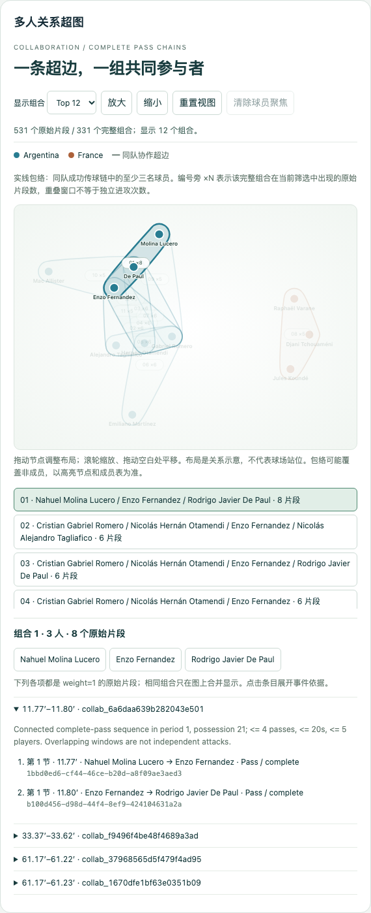
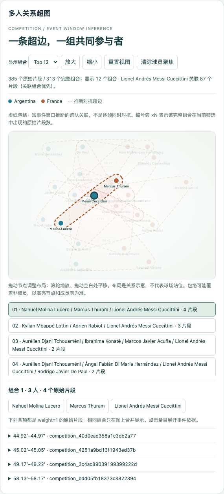

# Hypergraph Modeling and Visualization（B）

## 研究问题与超图定义

本模块回答 RQ2：如何保留三名及以上球员在同一有界片段中的共同参与关系？定义超图 `H=(V,E)`，节点为球员，一条原始超边为一个由事件支持的参与者集合，至少包含三名不同球员。普通两两连线无法单独保留“这些球员属于同一个片段”这一集合语义，因此主图使用完整包络表达超边，事件依据保留在每个原始片段中。

本项目的三人门槛是任务约定，不是声称数学上所有超图都必须排除二元边。协作边表示观察到的成功传球链，对抗边表示 D 提供的短事件窗口推断；两种来源在统一结构内表达，但证据类型和边界样式不同。

## 协作超边构建

输入为 A 规范化的球员和事件 JSON。按 `(period,event_index)` 恢复来源顺序，不按可能回退的比赛分钟排序；只保留第 1–4 节，排除点球大战。球员与球队通过字符串 ID 关联，不将名单人数理解为同时在场人数。

提取采用保守的连通成功传球链：每次 Pass 必须明确为 `complete`，发起者和明确传球对象同队且存在于名单，下一传球发起者必须是上一传球的对象。同队 Carry、Ball Receipt*、Dribble 可以连接相邻传球，但不额外增加参与者。其他事件、对手记录、失败/Unknown 传球、关键字段缺失、阶段/控球改变或时钟回退会切断链。此选择减少将意图接球者或不连续片段误写为已发生协作的风险，也会遗漏部分实际配合。

在每次成功传球末尾取有界尾部窗口，默认最多 4 次传球、20 秒、5 人。窗口内参与者去重达到三人才输出；超过人数上限跳过整个候选，不截断球员集合。原始超边记录真实 Pass ID、起止分钟、球队和稳定边 ID，固定 `weight=1`、`evidence_type=observed_event_sequence`。不同窗口可以重叠，因此片段数不是独立进攻次数；相同完整成员组合的频次在前端单独聚合。

## 视觉编码与布局

主视图用 D3 7.9.0 绘制一个 SVG。球员节点用球队颜色区分，文字及悬停提示给出姓名。布局由球员—超边关联驱动：内部虚拟超边节点参与力布局，不作为球员展示；布局坐标不代表实际球场位置。

同队协作包络使用实线及球队颜色；跨队对抗包络使用棕色虚线，持续提示事件窗口推断的性质。包络由各成员周围外扩采样点的凸包生成，并用闭合曲线平滑，使共线或重合节点仍有非零包络。包络可能几何覆盖非成员，选择后的节点高亮和完整成员表给出准确集合，避免将内部所有点都误读为成员。

为控制拥挤，默认显示频次最高的 12 个完整组合，可切换 Top 24；选择球员或 C 的特定组合后优先展示相关集合。图上 `×N` 表示当前筛选下这一完整集合对应的原始片段数；三个成员与增加第四个成员的集合分别统计。界面同时显示全部原始片段数、组合数和实际显示数。显示上限不会改变 C/D 的原始计数；原始 JSON 不被改写成聚合记录。

## 交互及多视图联动

模块通过 `mountHypergraph(container,store,dataset)` 接入 D 的入口，只操作本容器。球队和时间区间过滤、关系模式切换均订阅统一 store；球员选择只高亮相关超边、淡化无关元素，并不删除所有无关原始边。时间遵循全组相交规则：`end_minute>=start && start_minute<=end`。对抗边满足球队筛选时仍保留完整跨队成员。

鼠标拖拽节点、滚轮/按钮缩放、空白处平移和重置视图支持布局探索；球员节点可通过 Enter/空格选择、方向键移动。点击节点写 `selectedPlayerId`，C 面板同步；C 选择球员也会更新主图。点击包络、编号或组合按钮展示完整成员及所有对应原始片段，展开每条片段可读取时间、事件类型、传球人、对象、结果和源事件 ID。

C 的可选 `playeranalysis:select-edges` 冒泡请求进一步选择某个完整组合，不增加共享状态字段。模式、球队、球员、时间或数据改变后清除过期组合选择。组件销毁时清理 store 订阅、缩放/拖拽和文档事件监听；状态更新复用一个 SVG。

## 真实数据结果与案例

使用 A 固定版本的 2022 世界杯决赛数据，默认规则生成 531 条协作超边、331 个完整成员组合。独立审计逐条回到原始 StatsBomb 事件，核对源成功结果、前后传球连通性、所有中间事件、球队/控球/阶段、时间及完整参与者。

| 指标 | 实际结果 |
|---|---:|
| 阿根廷原始协作片段 | 302 |
| 法国原始协作片段 | 229 |
| 三人 / 四人 / 五人片段 | 262 / 187 / 82 |
| Messi 协作片段参与数 | 81 |
| Mbappé 协作片段参与数 | 32 |

真实示例 `collab_e19996044d23dfe97ecb` 来自上半场控球 11，源时钟 3:52–3:56，成员为 Cristian Romero、Ángel Di María、Lionel Messi。来源 Pass 为 `dcc37e05-d4f7-46ee-8697-9d0376ccccc0` 与 `91298d8c-a3ab-40d2-9776-ac2b9ba16c32`。三人作为同一四秒片段的整体出现，点击成员可进入 C 的个人分析，选择这条超边可回溯真实传球记录。这说明事件支持的共同参与，不证明该组合更高效或具有更大因果贡献。

阈值敏感性检查保持 20 秒和 5 人上限，改变最多传球数：

| 最多传球 | 原始片段数 | 完整组合数 |
|---|---:|---:|
| 2 | 471 | 211 |
| 3 | 520 | 300 |
| 4（默认） | 531 | 331 |

片段数量受参数和窗口重叠影响，不能把更多超边等同于更强协作。默认四次传球旨在保留局部多人关系并控制图形复杂度，没有被解释为足球战术的最优阈值。

## 验证与局限

验收包含算法及 CLI 正常/边界用例、真实五文件严格校验、B/C/D 在两种模式和精确时间端点上的计数一致性，以及真实浏览器中的缩放/平移/拖拽、球员与组合选择、空状态、生命周期、连续切换和窄屏检查。实际执行数量和命令见 [B 验收记录](../TEST_RESULTS_B.md)，复现与人工操作步骤见 [B 交接说明](../HYPERGRAPH_B.md)。模拟 fixture 仅用于边界测试，不充当比赛结论。

本方法只覆盖事件中确认的成功传球链，可能漏掉跨边界、长时间或无球协作；来源时钟有回退与补时重叠，按分钟的共享过滤不能表达精确阶段过滤。窗口相互重叠，个体参与数也受上场时间和球队控球量影响，未按每 90 分钟归一。包络重叠和 Top-K 会限制同时可见的组合数，使用准确名单、来源与明示显示上限降低误读。对抗边的证据解释沿用 D，不声称完整跟踪或真实同时站位。

## 贡献、来源与 AI 披露

B 负责协作边脚本、主渲染器、模块样式与离线 D3、相应算法/几何/浏览器测试、独立源数据审计、截图和本章及展示材料。A 的基础数据和 C/D 的生产模块不计为 B 的开发贡献。

Codex 辅助检查依赖、实现 B、运行测试与源数据审计、检查浏览器截图并起草报告和幻灯片。自动化结果不等同于成员本人逐行审核；个人代码审阅与最多三分钟排练需由成员实际完成后补记。比赛数值来自 StatsBomb 真实事件及程序审计，未由模型估计。

来源：[StatsBomb 固定版本](https://github.com/hudl/open-data/tree/4b73468fc5b0f1950f9f66fada70ad3a4f9327cb)、[事件字段规范](https://github.com/hudl/open-data/blob/4b73468fc5b0f1950f9f66fada70ad3a4f9327cb/doc/StatsBomb%20Open%20Data%20Specification%20v1.1.pdf)、[D3 官方源码](https://github.com/d3/d3/tree/v7.9.0)。D3 ISC 许可见 `src/js/vendor/D3-LICENSE`；数据署名与使用边界沿用 A 文档。
