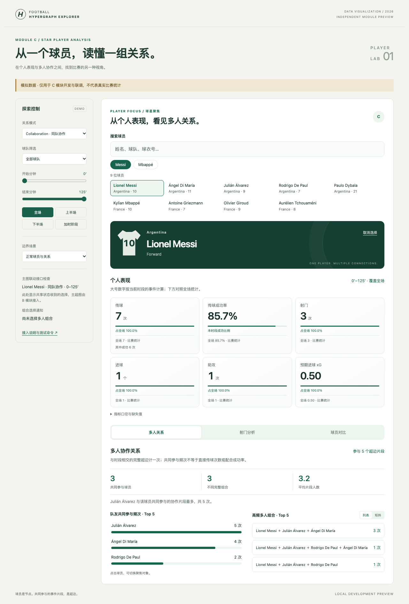
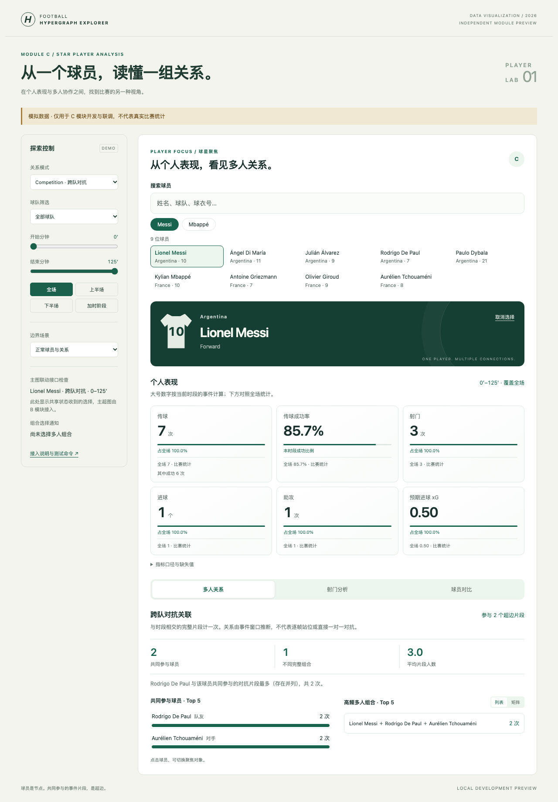

# Star Player Analysis（C 模块报告草稿）

> 状态：方法与实现草稿。当前截图和数值均来自明确标记的模拟测试数据；接入正式数据后再填写真实案例，不能将本稿中的开发验证当作比赛发现。

## 目标与研究问题

本模块回答：聚焦一名球员时，如何同时观察其个人事件指标以及他在多人关系中的参与方式？常规比赛统计提供传球、射门和进球等信息，超图则保留同一事件片段中三人及以上的共同参与集合。二者结合，可以从个体表现进入群体关系探索。

## 球员选择与局部超图

用户可以按姓名、球队、球衣号搜索，或使用 Messi/Mbappé 快捷按钮。选择操作仅更新统一 store 的 `selectedPlayerId`；主超图由 B 维护，在接入后响应该字段高亮包含球员的超边。本模块也订阅统一状态，因此主图内的选择可以反向更新个人分析面板。

设当前球员为 v，当前模式的原始超边集合为 E。筛选后的局部关系为所有包含 v、时间片段与选定区间相交、且满足球队筛选的边。这里只计算局部集合与指标，没有创建第二套超图渲染器。

## 常规指标与可解释的缺失状态

面板展示当前时段的传球、传球成功率、射门、进球、助攻和 xG，并在每项下方列出全场对照。时段指标由原始事件重新计算；全场对照优先使用 A 的汇总统计，并注明来源。

零值与未知值有明确区别。例如，零传球可确定为 0，但成功率因分母为零显示 N/A；射门存在而 xG 缺失时，不能将缺失值补零。缺少射门结果也不能推断未进球。事件契约未提供完整助攻标记时，局部助攻显示 N/A，仍可保留数据源已提供的全场助攻对照。点球大战事件不纳入事件指标。

具体公式、结果枚举、可选字段与边界行为见 `docs/PLAYER_C.md`。

## 超图特有指标

1. **超边参与次数**：当前筛选中含该球员的原始超边数量，每条边计一次，不使用展示层的聚合权重代替原始次数。
2. **共同参与球员频次**：对每条选中超边中的其他球员分别累计一次，以 Top 5 水平柱状图展示。
3. **高频完整组合**：将一条边的完整球员集合排序后作为组合标识，统计重复片段次数。三人组合与包含相同三人、另外增加一人的四人组合分别统计。

这些指标描述的是共同参与频次，不能直接解释为两人传球次数、协作成功率或因果贡献。重叠滑动窗口也可能共享原始事件，因此超边数不等于独立进攻次数。

## 视觉编码与交互设计

球员姓名、队伍和球衣号构成身份区。指标采用固定标签和大号数值，次要文字显示全场对照及缺失原因。共同参与频次用同一方向、相同基线的水平条形长度编码，并直接标注次数，方便比较。

多人组合以完整成员名单和次数表达，选中后展开片段时间、超边 ID 与事件 ID。协作模式称为“队友共同参与”；对抗模式改为“共同参与球员”，另用文本标注队友或对手，避免将颜色作为唯一的关系提示。

多人关系还可切换为成员矩阵：行表示球员，列表示一个完整组合，实心点标记成员归属。当前球员行突出显示，以便快速比较哪些成员在不同组合中保持不变。点击列标题与点击组合列表使用相同的证据集合；展开后直接阅读传球人、接球人、分钟与结果，并保留事件 ID。

搜索、快捷选择、模式、时间和球队通过统一状态联动。时间按边的区间相交过滤，因此跨越边界的原始片段完整计一次，界面对此作出说明。组合选择通过可选自定义事件请求 B/D 高亮特定超边；其接入状态在独立演示中明确展示。

界面支持小屏布局、原生键盘操作、可见焦点与状态播报，并为未选择球员、未知球员、无边和未提供关系数据提供不同反馈。

## 球员对比与射门探索

球员对比以同一时段的六项事件指标和两项关系统计组成成对条形图。每行保持相同量尺，不同指标独立保留原始单位。成功率差异以百分点呈现，避免将比例差与相对增长率混淆。比较对象留在本地状态，交换主副球员时才更新共享的 `selectedPlayerId`。计数不按上场分钟归一，也不汇总成缺乏依据的综合表现分。

射门视图使用来源位置绘制球场散点，实心/空心/虚线边界分别表示进球、已知未进球和未知结果，标记大小随有效 xG 增大。图上标记与可键盘操作的事件清单共享选中状态。位置缺失的射门保留在清单中，不能被补到球门或球场中心。该视图明确约定 120×80 坐标，不推断进攻方向；真实数据接入时须核对坐标体系。

这两个视角扩展了个人表现的探索方式，继续复用统一的数据与时段，并保留多人超边及其来源证据作为关系分析的基础。

## 开发验证

本地已运行 29 项统计测试和 15 项浏览器测试，共 44 项，覆盖指标计算、筛选边界、缺失值、模式切换、搜索、组合请求、清理订阅、多实例、快速状态变化、新增对比/射门/矩阵及响应式布局。浏览器测试使用模拟数据而非真实比赛验证，因此它证明实现按测试契约工作，不能证明真实赛事输入已经正确。

开发界面截图：

扩展视图截图见 [球员对比](../screenshots/player-c-demo-comparison.png)、[射门分析](../screenshots/player-c-demo-shots.png)、[成员矩阵与事件依据](../screenshots/player-c-demo-matrix.png)。最终报告按叙述选择 1～2 张真实数据截图。

## 真实案例（数据接入后补充）

- 赛事、数据版本与球员 ID：待 A 的正式数据。
- 选定时间段与组合：待真实超边。
- 观察及证据：记录实际次数、关联事件 ID，并说明当前窗口与全场的差异。
- 截图：替换上方模拟演示截图，同时加入 B 的实际主超图高亮。

## 局限

多人关系取决于 B/D 的建模规则。事件窗口推断的对抗关联不能替代逐帧跟踪事实；频次不能代表战术质量。按相交规则选择的片段可能跨越时间边界，滑动窗口可能重叠。助攻和其他结果字段的完整性依赖 A 的标准化口径。当前尚未完成与其他三个正式模块的集成验证。

## AI 辅助披露草稿

使用 Codex 辅助设计指标逻辑、编写 C 模块及模拟数据、调试自动化测试，并起草文档。自动化验证已实际运行。最终报告应补充本人实际进行的人工核对、真实数据检查和跨模块验证，避免声称已经完成尚未执行的验证。
