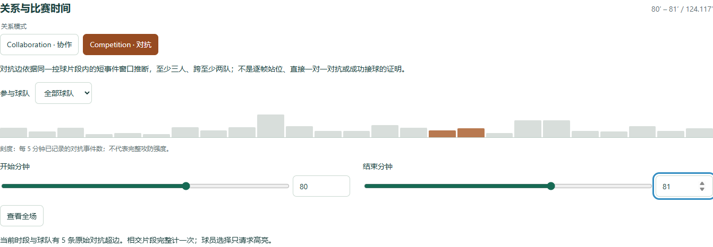

# 跨队对抗建模与时间交互分析

## 研究目标与数据基础

足球比赛中的一次攻防往往涉及多名球员。仅用两两连线表示关系，难以保留“哪些球员属于同一个比赛片段”的信息。本研究针对这一问题，将短时间内有事件依据的跨队参与者组织为竞争超边，并通过时间筛选连接超图视图与球员表现分析，支持用户从全场关系进入具体片段，再回查原始事件。

研究使用 StatsBomb Open Data 的 2022 世界杯决赛数据，比赛编号为 3869685，包含 50 名名单球员和 4407 条事件。建模使用常规时间与加时赛的 4386 条事件，排除 21 条点球大战事件。为保证可复现性，数据固定于同一源版本，并校验文件哈希。[1] 由于事件数据未提供全部球员的连续轨迹，本文研究的是**有限事件片段中的跨队关联**，其证据范围不包括完整逐帧站位。

## 对抗超边的构建

### 事件窗口与参与者

设球员集合为 V，竞争超图为 H=(V,E)。每条竞争超边对应一个有界事件窗口，其成员为该窗口内能够从原始记录追溯的球员。算法以实际出现的施压（Pressure）、争抢（Duel）、拦截（Interception）、失去球权（Dispossessed）或球权回收（Ball Recovery）事件为中心，提取同一阶段、同一连续控球片段内的邻近事件。设中心事件为 a、总窗口宽度为 Δ，则候选窗口满足：

\[
W(a,\Delta)=\{e:\ |t(e)-t(a)|\leq\Delta/2\}.
\]

默认总窗口宽度为五秒，即中心前后各 2.5 秒，并包含端点。参与者来自有效事件的发起球员，以及传球记录中明确记名、可在同队名单中核对的传球对象。上下文允许包含传球、带球、盘带、射门和接球记录，但候选窗口必须包含上述对抗事件之一。传球对象的记名本身不等于已经成功接球，不能据此推断传球结果。[2]

一条边须包含至少三名不同球员、至少两支球队，且双方均有实际发起事件。不满足门槛时不生成超边，不从球队名单、空间接近或球星身份补入未记录的参与者。这一约束使集合具有明确的多人语义，并减少仅凭时间共现制造跨队关系的风险。

### 连续性、规模与去重

事件按比赛阶段和源序号排列，而非仅按可能回退的秒数排序。算法在连续控球片段内构建窗口，遇阶段变化、控球变化、关键身份或时间缺失、球员球队不一致及片段内时钟倒退时切段。后来再次出现的相同控球编号也不用于拼接非连续片段。

| 参数 | 默认值 | 作用 |
| --- | --- | --- |
| 总窗口宽度 | 5 秒 | 限定邻近事件的关联范围 |
| 最小成员数 | 3 人 | 表达多人共同参与 |
| 跨队证据 | 至少两队，双方有发起事件 | 确保跨队成员有实际来源 |
| 最大规模 | 8 名球员、24 个上下文事件 | 控制片段规模与显示复杂度 |

超出上限时跳过整个候选，不截断成员集合。完全相同的有序来源事件序列只保留一次；相同球员在不同时刻形成的片段仍分别保留。每条原始边保存完整成员、球队、源事件编号和实际起止时间，权重固定为一，证据类型标记为事件窗口推断。展示时可以按完整成员集合聚合频次，但原始片段及其证据保持可查。

这一方法允许不同窗口重叠，因此原始边数不应解释为互相独立的争抢次数。五秒等阈值是控制关联范围的设计选择，其影响需要结合敏感性分析讨论。

## 时间交互与视觉表达

系统提供协作（Collaboration）与对抗（Competition）两种模式，并在同一个主超图中切换数据。球员节点以队色区分，对抗包络采用棕色虚线，界面同时说明其事件推断性质。关系布局便于观察成员集合，不表示真实球场位置。点击包络可以展开完整成员与来源片段，避免仅凭几何覆盖判断成员。

时间筛选使用两个端点滑块和可输入的小数分钟框，支持全场重置、精确边界与零宽区间。最大分钟从数据计算，端点交叉时将另一端推至相同值。对于选定闭区间 [s,t]，保留与其相交的超边，即满足：

\[
e_{\mathrm{end}}\geq s\quad\text{且}\quad e_{\mathrm{start}}\leq t.
\]

触及边界的片段完整计一次，不裁切成新的超边。个人指标则由区间内的事件点重新计算，并与全场值分开显示。由此，关系计数与传球、射门等指标可以使用同一时间范围，同时保留各自的统计语义。

选择球员会同步更新个人面板并高亮相关超边；球队筛选保留包含该队的竞争边，同时保留边中的全部跨队成员。主图为控制拥挤只显示频次最高的部分组合，并明确显示数量上限；这不会减少原始片段总数和球员参与量。

时间条另按五分钟汇总已记录的对抗事件数，提供导航参考。它反映事件记录分布，不等于独立对抗次数或完整攻防强度。源时钟保留了补时与下一阶段可能重叠的分钟，因此分钟筛选不等同于限定比赛阶段，事件详情仍保留阶段和源顺序。

## 多视图集成与一致性

数据预处理、唯一主图、球星分析和时间控件通过同一份数据对象及共享状态连接。模式、球队、球员和时间范围变化后，各视图订阅状态并更新，不重新创建整套主图。球星面板选择完整组合也可请求主图高亮，主图选择球员则反向更新个人分析。这种双向联动使用户能够在集合关系与个体表现之间切换。

加载阶段检查数据结构、唯一标识、引用、参与者来源和时间一致性。界面区分“关系文件未提供”与“文件有效但当前没有符合条件的关系”：前者说明数据不可用，后者是有明确证据门槛的空结果。对于数据损坏或证据不一致的情况，系统显示具体原因，不以模拟值补齐。这些处理有助于防止缺失信息被误解为比赛事实。

## 结果与案例分析

### 全场关系与窗口敏感性

默认规则生成 385 条原始竞争超边。636 个有效锚点候选中，164 个窗口未达到证据门槛，87 个与已保留的来源序列重复，最终保留 385 条。成员规模分布如下。

| 参与人数 | 原始竞争边数 |
| --- | ---: |
| 3 人 | 167 |
| 4 人 | 132 |
| 5 人 | 51 |
| 6 人 | 31 |
| 7 人 | 4 |
| **合计** | **385** |

在该规则下，Messi 参与 87 个竞争窗口，Mbappé 参与 47 个。此数值表示建模规则下的片段参与量，不能单独作为对抗能力或比赛贡献排名。

固定其他参数后，三秒、五秒和八秒总窗口分别生成 297、385 和 440 条边。扩大范围会改变窗口中的事件及成员集合，也会影响去重结果。本场数据表明输出数量对窗口宽度敏感，但数量增加本身不能证明关系更准确或竞争更激烈，也不足以认定五秒为最优设置。

### 案例一：同一片段中的四名跨队参与者

上半场 02:11–02:14、控球片段 8 中存在如下记录：

| 源时钟 | 原始事件类型 | 明确参与依据 |
| --- | --- | --- |
| 02:11 | Pass | Tagliafico 传给 Mac Allister |
| 02:11 | Ball Receipt* | Mac Allister 的接球记录 |
| 02:13 | Pressure | Griezmann 的施压记录 |
| 02:14 | Pass | Mac Allister 传给 Messi |

以 02:13 的施压事件为中心，四条记录均在前后各 2.5 秒内。Tagliafico、Mac Allister 和 Messi 属于阿根廷，Griezmann 属于法国，双方都有实际事件，因而得到四人跨队超边。该结果保留了一个片段的完整成员关联，但不能证明四人同时聚集在某处，或其中任意两人发生了直接争抢。

*图 D-1：2022 世界杯决赛的对抗模式主视图。棕色虚线包络表示事件窗口推断，节点颜色区分球队。截图展示整体界面；上述具体案例以来源记录为依据，不假定其一定处于截图的可见组合中。*

### 案例二：时间筛选与个人表现对照

选择 Mbappé，并将对抗模式的源分钟区间设为 [80,81]，共有五条原始竞争边与该范围相交。个人面板的时段进球为一粒，全场对照仍为三粒，均排除点球大战。区间中的进球来自下半场源时钟 80:59、结果为 Goal 的射门事件。

*图 D-2：正式页面的对抗模式与 80–81 源分钟筛选。个人指标与主图使用同一时间范围，控件显示当前片段计数及其含义。*

该案例说明，系统能够将关系探索限制在一段比赛内，同时保留个人指标的全场参照。进球与竞争窗口同时出现在该范围，仅说明时间共现，不能据此推断某条竞争边导致了进球。

## 验证与讨论

独立核对程序直接读取固定版本的原始事件，逐条验证全部 385 条边的参与者、球队、阶段、控球连续性、中心窗口、准确时间和单位权重，不以重复调用提取函数代替证据验证。默认规则重新提取的结果与已生成文件一致。四人案例对应边 `competition_b71fd25dda4784e0e4c4`，80:59 进球对应源事件 `03fb2918-e1e7-4ec8-89ff-7bc5531e853d`，可用于复核案例。

功能验证覆盖空结果、人数门槛、窗口端点、阶段与控球边界、重复来源、非法引用及快速状态变化。已执行的相关测试包括十二项算法测试和二十五项状态、主图与真实集成测试，均通过。真实浏览器验证还覆盖模式切换复用同一主图、时间与球队筛选、球员双向选择、组合高亮、连续切换与小屏布局。这些结果支持实现与统计一致性，尚不构成用户研究，也不能证明界面提升了战术判断能力。

验证仍存在环境边界：完整浏览器回归中四十四项通过，十五项独立演示测试在 Windows 路径检查处失败；临时副本修正路径处理后通过，但未据此宣称原版套件全部通过。该问题属于复现环境与测试服务的限制，应与真实页面的已验证行为分开解释。

本方法的主要局限有三方面。首先，事件数据稀疏，未记录的无球球员与同时位置无法纳入，空结果不代表没有对抗。其次，短时间共现仍可能误关联，严格控球边界又可能漏掉跨控球争抢，保守规则同时存在误差与遗漏。最后，窗口重叠、记录密度和阈值都会影响频次，关系数量不能直接解释为强度、成功率或因果贡献。

后续可通过人工标注样本评估误关联与漏识别，并比较不同窗口参数下的关系稳定性。在数据可用与许可允许的前提下，结合追踪轨迹可进一步检验事件推断与实际空间互动之间的差异。

## 小结与贡献说明

本研究以可追溯的事件窗口表达跨队多人关系，并将模式、时间、球队和球员选择连接到同一分析流程。真实案例与来源核对表明，系统可以保留完整成员集合、支持时间探索，并让用户回到事件依据理解关系。

D 部分负责竞争超边建模、统一状态、模式与时间控件及页面集成。数据处理与比赛概览、唯一主超图渲染器、球星分析分别由其他成员完成。项目使用 Codex 辅助方法设计、实现、测试与材料整理。

## 参考文献与复核材料

[1] StatsBomb. *Open Data: FIFA World Cup 2022 Final, Argentina–France*. Match 3869685，固定版本 [4b73468fc5b0f1950f9f66fada70ad3a4f9327cb](https://github.com/hudl/open-data/tree/4b73468fc5b0f1950f9f66fada70ad3a4f9327cb)。数据许可及署名依据：[官方许可副本](../data_source/StatsBomb-LICENSE.pdf)。

[2] StatsBomb. *Open Data Specification v1.1* 与 *Open Data Events v4.0.0*。字段语义、固定版本和数据处理口径见项目附录 [DATA_A.md](../DATA_A.md)。

复核实现与运行记录随代码附录提供：[竞争超边构建](../../scripts/build_competition.py)、[原始事件独立审计](../../tests/audit_competition_D.py)、[验证记录](../AUDIT_2026-10-30.md)。这些材料支撑来源与实现复核，不替代人工标注的真实对抗关系。
